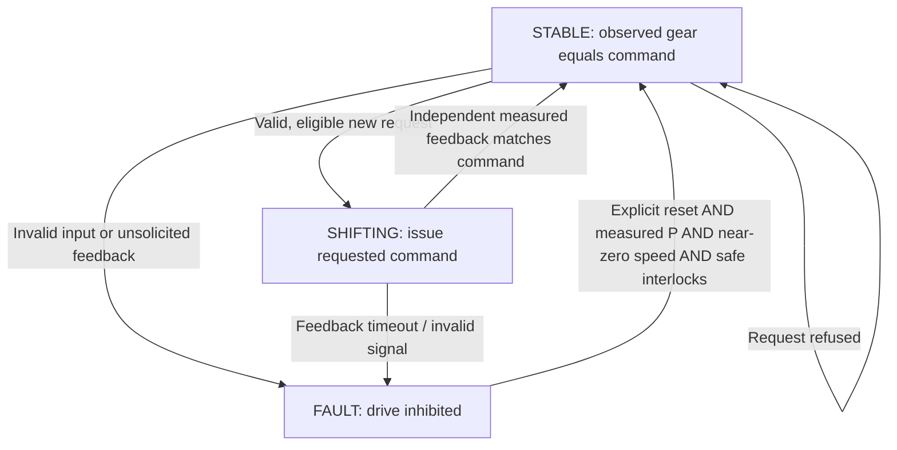

# Gear & Drive Interlock — educational model v7

## Scope and existing reuse
- Existing `simulation/src/runtime/gear/GearLogic.ts` validates a requested shift against validity and a direct D/R direction-change threshold. Retained unchanged: the simulation runtime may continue using it.
- Existing `src/campaign/vehicleModeModel.ts` owns VCU OFF/READY/DRIVE and higher-level safety; unchanged.
- Existing `src/campaign/vehicleSystems.ts` owns simplified motor/brake plant and legacy D-only drive permission; unchanged for old call sites.
- Added `src/campaign/gearInterlockModel.ts` to distinguish driver request, ECU gear command, and measured engagement feedback.
- Added **opt-in** `stepVehicleSystemsWithGear()` and `stepVehicleSystemsWithModeAndGear()` in `vehicleSystems.ts`. All old APIs and existing test expectations are preserved.

## Signal and ownership contract (all ticks `dtSec=0.02 s` default, allowed 0 < dt <= 0.1 s)
| Signal | Unit/type | Ownership / meaning |
| --- | --- | --- |
| requestedGear | enum P/R/N/D | Observed driver request; *not* gear engagement |
| observedGear | enum P/R/N/D | Independently observed gear/actuator state |
| requestAgeMs, feedbackAgeMs | ms | Age of each independent signal; 0..100 ms accepted |
| speedKmh | km/h (signed allowed) | Measured vehicle motion; use abs value for low-speed shift gating |
| brakePct | % 0..100 | Driver brake request; >=5% permits P/D/R engagement in this simplified calibration |
| vehicleReady | bool | VCU ready permission, not physical gear state |
| powerAvailable | bool | Power/HV/BMS permission independently calculated upstream |
| interlockOk | bool | Externally validated interlock; no auto-inference from UI |
| blockingFault | bool | Upstream supervisory blocking condition |
| resetRequested | bool | Explicit fault reset attempt |
| command.targetGear | enum | ECU gear command; not evidence physical shift succeeded |
| feedback.actualGear | enum | Independently received observed gear |
| feedback.confirmed | bool | Command matches feedback while model is STABLE and not faulted |
| permissions.forwardAllowed | bool | D engagement confirmed + all gating conditions |
| permissions.reverseAllowed | bool | R engagement confirmed + all gating conditions (legacy plant **does not** implement reverse torque) |
| permissions.driveAllowed | bool | D or R direction permitted; not a claim of physical motor output |
| permissions.direction | -1,0,+1 | R, inhibited, D, respectively |
| diagnostics.fault | enum/null | Latched invalid request, invalid feedback, timeout, or uncommanded gear change |

## Controller state flow

- Reject P/D/R shifts if absolute speed >1 km/h or brakePct <5%. N is allowed at speed (simplified educational choice).
- Reject D/R commands without independent VCU READY, power availability, and interlock permission.
- During a pending shift, block drive output. New driver requests do not override pending command.
- Once command and feedback match, enable permitted direction only if upstream guards are still true.
- Observe an unsolicited gear change in STABLE -> latch `GEAR_UNCOMMANDED_CHANGE`.
- If command has not been confirmed after 0.4 s -> latch `GEAR_FEEDBACK_TIMEOUT`.
- To clear fault, require explicit reset, P request and actual P, safe interlock, no external block, speed <=0.5 km/h. This is a game/education reset policy, not a production reset procedure.

## Physical response versus command
`stepGearInterlock()` computes an ECU supervisory command and permissions; it **never** writes `observedGear` on its own. `stepGearPlant()` is a minimal, optional actuator simulator with a configurable shift delay and stuck-actuator injection. A command may be sent even when physical feedback remains unchanged.

## Integration and limitations
1. In a realistic integration, feed actual/plant-observed gear to `gearObservations.observedGear` and back to the VCU; never substitute the driver's requested gear.
2. `stepVehicleSystemsWithGear` gates the existing D-only vehicle plant using independently confirmed gear state and preserves the old brake-override policy (`brakePct >= 5` gates propulsion in that plant). It does **not** redefine brake override in the gear controller.
3. `stepVehicleSystemsWithModeAndGear` also passes feedback gear to VCU; existing Vehicle Mode state must be managed by the caller.
4. The v6 combined BMS/HV/VCU adapter is not silently modified. A higher-level orchestrator still needs to wire BMS/HV/VCU/Gear states each tick; this is **not yet a fully connected production/game simulation**.
5. R engagement yields `reverseAllowed=true`, but *no reverse torque* in the legacy D-only plant. R command cannot be interpreted as completed reverse-drive support.
6. At speed, this simple model permits shift to N and inhibits torque. Parking pawl interlocks, transmission internals, neutral coast strategies, safe electrical actuation, feedback debounce, redundant sensor voting, brake-hold mechanics, hill-start assist, roll direction, and gear-selection HMI policies are not modeled.
7. No game UI changed; use screen-independent `requestedGear`, `observedGear`, and `diagnostics` outputs in the existing memo board / logic desk / reference-vs-actual lab flow.

## Suggested sentence-level blocks for tutorial
- `기어 요청 신호가 유효한가?`
- `주행 방향 전환 조건을 충족했는가?`
- `P/D/R 전환에는 저속·브레이크 조건이 필요한가?`
- `VCU READY와 전력 사용 허용인가?`
- `기어 명령과 실제 피드백이 일치하는가?`
- `피드백이 시간 내 도착했는가?`
- `허용 조건과 실제 기어가 D일 때 전진 토크를 허용한다`
- `고장 시 구동을 차단하고 안전한 리셋 조건을 확인한다`
The UI need not show `pendingSec`, time tick accumulation or full actuator mechanics. Expose short evidence traces and expected/actual comparison for an educational fault scenario, not a dashboard.

## Test coverage
`tests/gear-interlock-educational.test.mjs` exercises nominal P→D, command-feedback separation, signal age boundary, stale/invalid feedback, speed/brake boundaries, VCU/HV guarding, N at speed, D→R refuse/confirm, no-HV N→D refuse, feedback timeout, uncommanded change, safe reset, pending-request blocking, stuck actuator, timing validation, legacy torque gating, no invented reverse torque, brake override separation, VCU adapter, and deterministic behavior. All calibration constants are illustrative and not OEM specifications.
