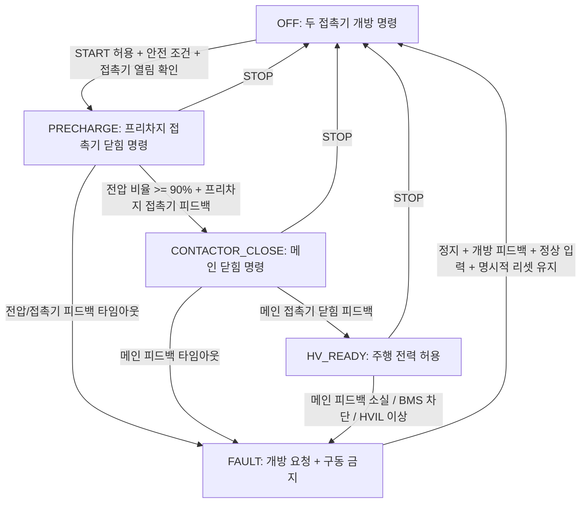

# TraceBack HV 연결 제어 — 교육용 모델 v5

## 범위
기존 BMS v4 소스 기반으로 **HV 프리차지·메인 접촉기·전원 준비 상태** 모델을 `src/campaign/hvModel.ts`에 독립 구현. 실제 접촉기 구동·정비 절차가 아닌 학습 목적의 추상화이며, 실제 차종의 안전 전략/전압/시간 기준과 무관하다.

## 상태 흐름

## 신호 및 단위
| 분류 | 필드 | 단위/의미 | 소스 |
|---|---|---|---|
| 입력/외부 조건 | startPermit, stopRequested, resetRequested | bool | 상위 차량 제어/플레이어 요청 |
| 입력/외부 조건 | packSafe, hvilOk, insulationOk, bmsShutdownRequested | bool | BMS/보호·인터록 |
| 측정 | packVoltageV, dcLinkVoltageV | V | 전압 센서 |
| 측정 | signalAgeMs | ms | 통신 신선도 |
| 측정 | vehicleSpeedKmh | km/h | 차량 속도 |
| 액추에이터 피드백 | prechargeFeedbackClosed, mainFeedbackClosed | bool | 실제 접촉기 피드백(또는 가상 플랜트) |
| ECU 상태 | mode, elapsedSec, recoverySec, fault | 상태, s, s, 코드 | `stepHv` 계산 |
| ECU 명령 | commands.prechargeClose, commands.mainClose | bool | 접촉기에 요청하는 명령, 실제 상태 아님 |
| 차량 허용 | hvReady | bool | `HV_READY`와 메인 피드백·안전 조건을 모두 만족할 때만 참 |
| 진단 | prechargeRatio, diagnostics, faults | 비율, 검사 결과, 코드 | 모델 계산 |

### 핵심 판단
1. 유효성: 숫자 유한성·전압 측정 범위·타임스탬프/신호 시간·bool 형식 검사.
2. 시작 허용: BMS 사용 허용, HVIL, 절연 상태, START 요청, 접촉기 개방 피드백.
3. 프리차지: DC-link/팩 전압비가 0.90 이상인지 확인. 단 전압비만으로 READY에 들어가지 않고 메인 접촉기 피드백까지 필요.
4. 타임아웃: 프리차지 접촉기 피드백(0.2s), 전압 상승(2s), 메인 접촉기 피드백(0.3s).
5. 안전 대응: 진단·차단 요청 시 접촉기 개방 **명령**과 구동 금지. 실제 접촉기 응답은 별도 피드백으로 확인.
6. 복귀: 명시적인 STOP/RESET, 정지, 개방 피드백, 입력 정상 상태가 0.1s 유지돼야 FAULT 해제.

교육용 설정 값은 `HV_CALIBRATION` 참조. `dtSec`은 (0, 0.1]초이며 테스트 기본 주기는 0.02초.

## 액추에이터 가상 응답
`stepHvPlant`는 접촉기 지연(0.04s)과 DC 링크의 지수형 전압 상승/방전(시뮬레이션용 시정수)을 별도로 계산한다. `prechargeStuckOpen`, `mainStuckOpen`, `mainWelded`, `prechargeWelded`, `noVoltageRise`를 주입할 수 있다. 컨트롤러는 플랜트 피드백을 **입력으로만 수신**한다. 가상 플랜트의 전압 변화는 전력 회로·실제 방전/감전 안전 여부를 보증하지 않는다.

## 차량·BMS 통합
- 기존 API `stepVehicleSystems`, `stepVehicleSystemsWithBms`는 유지.
- 신규 선택 API `stepVehicleSystemsWithHv`: 기존 차량 모델에 HV 제어 상태·명령을 반영하고 준비되지 않은 상태에서 구동 출력을 차단.
- 신규 선택 API `stepVehicleSystemsWithBmsAndHv`: BMS의 `packAvailable`/`shutdownRequested`를 HV 시작 허용·중단 요청에 반영.
- 기존 `stepVehicleSystems` 내 과거 단순 HV 상태기는 **하위호환 목적으로 유지**. 실제 게임에서 신규 HV 옵션을 채택하면 둘의 상태를 병렬 구동하지 않도록 상위 호출 경로를 한 가지로 선택해야 한다.

## 게임에서 직접 조립하기 적당한 문장 블록
- `BMS가 배터리 사용을 허용하는가?`
- `HVIL과 절연 상태가 정상인가?`
- `START 허용 + P기어/브레이크 조건을 만족하는가?` (후자는 상위 Vehicle Mode 책임)
- `프리차지 전압 비율이 기준 이상인가?`
- `메인 접촉기 닫힘을 실제 피드백으로 확인했는가?`
- `타임아웃 또는 인터록 이상이면 HV_READY를 금지한다`

상태기의 타이머/명령·피드백 지연과 가상 물리 모델은 게임 엔진이 자동 실행한다. UI에서 사용자에게 모든 내부 로직을 배선하게 하지 않는다.

## 한계 / 위험과 남은 연계
- 메인·프리차지의 단순 추상 상태만 표현. 실제 양극/음극 접촉기, 병렬 저항, 전력 소모, EMI, HV 안전 절차 구현 아님.
- READY에서 HVIL/절연 문제 발생 시 개방을 요청하는 단순 정책. 실차 안전상태 진입의 지연·고장전파·전력 차단 정책을 대표하지 않음.
- 실제 DC 링크 고전압 잔류를 판단하는 방전/서비스 안전 로직 없음.
- BMS `SHUTDOWN_REQUEST`는 전원 차단 명령이 아니며, 피드백 확인 전 실제 접촉기 개방을 단정하지 않음.
- HV 진단 및 액추에이터 모형은 기존 Stitch 메모판/로직 편집/쌍둥이 시험대 게임 UI와 아직 연결되지 않았음.
- 구동 토크·BMS 전력 변환의 정확한 물리 단위 통합은 별도 개선 대상.
