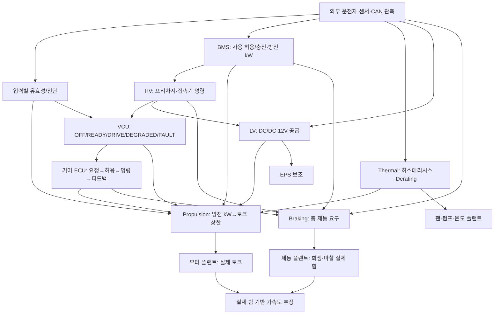

# TraceBack v14 — 교차 도메인 통합 제어 (교육용)

## 0. 범위 및 사용 제한

기존 v13 (`TraceBack_CommunicationDiagnostics_v13_FULL_SOURCE.zip`) 소스에 독립적인 `stepIntegratedVehicle`를 추가했다. 이 실행기는 CAN 버스 시뮬레이터, 양산 ECU, 기능안전 설계, 실제 차량의 구동/제동 물리 모델, 게임 UI 실행기가 아니다. 기존 `stepVehicleSystems` 및 각 ECU 모델의 공개 API를 바꾸지 않는다. 주행 속도는 호출자가 센서값으로 입력하며 게임 물리 엔진에 쓰이지 않는다. 간단한 종방향 힘·가속도 추정값만 별도로 출력한다.

## 1. 재사용 소스 목록

| 소스 | 재사용 기능 |
|---|---|
| `bmsModel.ts` | SOC/셀/절연 검증, 배터리 방전·충전 한계 (kW) |
| `hvModel.ts` | 접촉기 상태기, 프리차지 전압 증가, 피드백 |
| `vehicleModeModel.ts` | OFF/INIT/HV_PREPARING/READY/DRIVE/DEGRADED/FAULT |
| `gearInterlockModel.ts` | 기어 요청·실측 기어, 전환 허용, 교착 진단 |
| `propulsionModel.ts` | 페달 A/B, 요구 토크, 전력/열/VCU 토크 상한, 변화율·추종 진단 |
| `brakingModel.ts` | BMS 충전 한계에 따른 회생·마찰 제동 배분, 피드백 |
| `epsModel.ts` | 차속/토크 보조량, EPS 전류/토크 응답 |
| `thermalModel.ts` | 팬 히스테리시스, 펌프, 온도 변화·토크 제한 |
| `lvPowerModel.ts` | LV 배터리, DC/DC, 부하 제한 및 전압 응답 |
| `communicationDiagnosticsModel.ts` | 채널 검사, Debounce/래치, 명시적 기능별 정책 |
| `vehicleSystems.ts` | 이전 단순 차량 추정·선택형 통합 함수: **변경하지 않음** |
| `src/engineering/torqueModel.ts` 및 게임 로직 블록 | **자동 통합하지 않음**. 별개 엔진이며 플레이어 편집 결과 미반영 |

## 2. 공통 시각/스텝 규약

- `dtSec`는 0보다 크고 0.1초 이하, 기본 0.02초(20ms). 입력 `signalAgeMs`, `feedbackAgeMs`는 ms. 센서값 신호 신선도 한계는 담당 ECU 별로 다르므로 각 모델이 검사한다.
- `previous`의 액추에이터 관측값(한 샘플 전)을 **현재 ECU 입력**으로 이용한다. 이어 `BMS → Thermal → HV → VCU → Gear → LV → Propulsion → Braking → EPS`를 계산하고, 마지막에 `HV/Gear/Motor/Brake/Thermal/EPS/LV` 플랜트를 한 번씩 진행한다. 공통 진단은 ECU 평가 직전에 실행한다.
- HV START는 **이전 VCU `HV_PREPARING` 상태**에서 들어간다. 이 보수적 한 주기 지연은 인과관계를 명시한다. BMS SHUTDOWN/과열 긴급 차단은 같은 주기 HV·토크 명령에 반영된다. 물리 접촉기의 실제 개방/모터 토크 소실은 지연된다.
- `measured`: 이전 플랜트의 측정값. `ecu`: 이번 평가에서 결정한 상태·목표·명령. `actual`: 현재 명령을 받은 뒤 전진한 플랜트값. `state`는 다음 호출에 넘길 불변식 지향 실행 상태. `arbitration`은 진단용 출력 요약.

## 3. 신호 계약

| 값 | 공급원 | 단위/타입 | 소비자 | 판단 의미 |
|---|---|---|---|---|
| `bms.socPct` / `cellMinV` / `cellMaxV` | 배터리 관측 | %, V, V | BMS | 전력 사용 유효성·제한 |
| `bms.packVoltageV`, `packCurrentA` | 배터리 관측 | V, A | BMS/HV | 전력 한계, 프리차지 기준 |
| `bms.limits.dischargeKw` | BMS 계산 | kW | Propulsion | 모터 토크 가용 상한으로 환산 |
| `bms.limits.chargeKw` | BMS 계산 | kW | Braking | 회생제동 상한으로 환산 |
| `hv.hvReady`, `hv.commands` | HV ECU | Boolean | VCU/구동·LV/HV 플랜트 | READY와 실제 접촉기 피드백은 다름 |
| `hvPlant.*Closed`, `dcLinkVoltageV` | HV 플랜트 | Boolean, V | HV ECU | 다음 주기 접촉기·전압 피드백 |
| `vehicle.permissions.driveAllowed` | VCU | Boolean | Gear/Propulsion | VCU 운용상 허용 |
| `gear.permissions.forwardAllowed` | Gear ECU | Boolean | Propulsion/Braking | D 실제 확인 기반. R은 후진 모터 미모델링 |
| `pedalA_pct`, `pedalB_pct`, `brakePedalPct` | 운전자 입력 | % | Propulsion/Brake | 요구값; 신호 age 별도 |
| `propulsion.command.motorTorqueNm` | 구동 ECU | Nm | 모터 플랜트 | 구동 요청, 실측 아님 |
| `motorPlant.actualTorqueNm` | 모터 플랜트 | Nm | 구동 ECU/종방향 추정 | 실측 모사 |
| `braking.command.{regen,friction}RequestN` | Brake ECU | N | 브레이크 플랜트 | 회생·마찰 독립 요청 |
| `brakePlant.actual*ForceN` | 브레이크 플랜트 | N | 브레이크 ECU/종방향 추정 | 실측 모사, 부족분 계산 |
| `thermal.command.torqueLimitScale` | Thermal ECU | 0..1 | Propulsion | 별도 소유 보호 요청; VCU 제한과 Min |
| `thermal.command.{fanOn,pumpRequestPct}` | Thermal ECU | Boolean, % | Thermal 플랜트 | 요구된 냉각 동작 |
| `thermalPlant.motorTempC` | 냉각 플랜트 | °C | Thermal/Propulsion | 이력에 따른 온도 |
| `lv.feedback.lvPowerAvailable` | LV ECU | Boolean | Propulsion/EPS | 12V 공급 가능 판단; 실측 전압과 분리 |
| `diagnostics.events` | Diagnostic ECU | 코드·심각도 | 지정된 소비 ECU | 매핑된 채널만 제어 정책 적용 |
| `actual.accelerationEstimateMs2` | 장난감 종방향 추정 | m/s² | 시험 관찰 | 실제 모터 토크·회생/마찰 힘으로 계산. 게임 속도와 미연결 |

모터 토크 한계(kW→Nm)는 기존 `propulsionModel.ts`의 고정 효율과 저속 회전수 floor를 사용한다. 제동의 회생 배분은 기존 `brakingModel.ts`의 모터 토크/차속/배터리 충전 전력 제한을 사용한다. 종방향 추정은 1,500kg, 기어비 7, 효율 0.9, 바퀴 반경 0.425m의 **순수 교육용** 고정값이다.

## 4. 통합 제어 흐름



※ 단순 보기용 개념도. 실제 코드에서 진단 평가·ECU 계산·플랜트 갱신은 각각 한 번이며, 피드백은 다음 틱에만 들어온다.

## 5. 충돌 시 보호 우선순위

1. **BMS 셀/절연 위험·HV 인터록·Thermal 치명 고장·VCU 치명 고장:** 같은 제어 주기에 구동 토크 **명령**을 0으로 지정. 구동 모터·접촉기 *실제 상태*는 별도 플랜트 응답에 의존한다.
2. **신호 invalid / 연결된 BLOCK 진단:** 구동 명령 0. 공통 진단은 반드시 `diagnosticDomainChannels` 매핑된 경우에만 특정 도메인에 적용한다.
3. **Brake Override:** 5% 이상 브레이크 페달 입력(교육용 정책)에선 구동 토크 명령을 즉시 0, 제동 협조는 독립 실행한다.
4. **LIMIT 진단 / VCU DEGRADED / Thermal derate / BMS 방전 제한:** 명령 가능한 토크의 상한 `min()`; 즉시 제한 하향, 정상 증가에는 변화율 제한.
5. **BMS 충전 상한 / ABS / 저속:** 회생 상한을 제한하고 마찰제동 요구를 보완한다. 실제 마찰제동이 고장일 수 있어 총 제동력의 보장은 하지 않는다.

## 6. 복구·상호작용의 사실 범위

- HV, VCU, Gear, Propulsion, Brake, EPS, Thermal, LV 각각의 **원본 상태기**가 가진 리셋/정차 요구를 유지한다. 이 통합 실행기는 고장 래치를 우회하지 않는다.
- 진행 중 추리 화면이 열려도 `IntegratedVehicleState`가 자동 변경되지 않는다. 게임 레이싱 시계와 ECU 시계는 별도이며, 게임이 시뮬레이션 틱을 주기적으로 호출할지는 미연결이다.
- VCU 고장 복귀는 HV OFF·P·정차·명시적 리셋을 요구한다. 주행 중 OTA 연출은 안전한 복구의 증거가 아니다.
- 현재 **플레이어 문장형 블록이 바뀌면 통합 ECU 결과가 바뀌는 기능은 미구현**이다. 게임 퍼즐용 `TorqueModel`과 통합 ECU는 별도 엔진이다.
- 이 실행기는 실제 게임의 가감속·물리 충돌, 휠별 제동, 조향 각도, 추격 거리 및 AI를 직접 조작하지 않는다.

## 7. 게임 노출 블록과 내부 자동 실행

플레이어에게 노출 후보: (1) 신호가 최신/유효한가, (2) BMS/HV READY 조건, (3) 실제 D 기어 확인, (4) 구동 토크의 여러 상한 중 Min, (5) Brake Override, (6) 회생 부족분을 마찰로 보완, (7) 팬 ON/OFF 히스테리시스, (8) 명령/실제 응답 비교. 각 사건은 4~6개만 사용.

내부 자동 처리: 전압 프리차지 동역학, 셀 전압 LUT, 모터 토크 단위 환산, 전류/전압 제한, 서브모델 통합 틱/피드백 저장, 고장 Debounce 시간, 각 실제 액추에이터 1차 응답 및 종방향 가속도 교육용 추정.

## 8. 실행 및 테스트

```bash
node --experimental-strip-types --test tests/integrated-vehicle-educational.test.mjs
node --experimental-strip-types --test tests/*.test.mjs
# 의존성 설치 및 Node 요구 버전 충족 이후, 별도로 npm run build
```

## 9. 단순화·미검증 항목

- 정밀 전기/배터리·열/유압·모터·서스펜션/조향 동역학 없음.
- SOC는 명시된 관측값 입력. BMS 전류는 별도 실측 입력이며 계산한 모터 전력으로부터 자동 역산하지 않는다.
- 게임의 차량 속도·회전수는 외부 측정값; 내부에서 차량 전체 속도를 적분하지 않는다. `accelerationEstimateMs2`는 교육용 독립 지표다.
- 실제 CAN 전송 지연, 프레임 분할·E2E/CRC/UDS/DTC 표준은 미구현; 신호 age/validity 사용.
- 실제 HV 상태기에는 고장 상태별 안전 조치가 차종에 따라 크게 다르고 본 모델은 이를 재현하지 않는다.
- 복수 고장 우선순위와 VCU 복귀 정책을 OEM 요구사항처럼 일반화하지 않는다.
- 기존 간이 `vehicleSystems.ts` 및 Simulation 런타임과의 이중 계산 경로는 정리하지 않았고 실제 게임 UI 연결도 하지 않았다.
- LV 플랜트의 교육용 DC/DC 상승 중 12V 배터리 버스 유지와 출력 상승속도를 보정했다; 관련 원본 테스트 및 통합 시동 시나리오로 확인했다.
