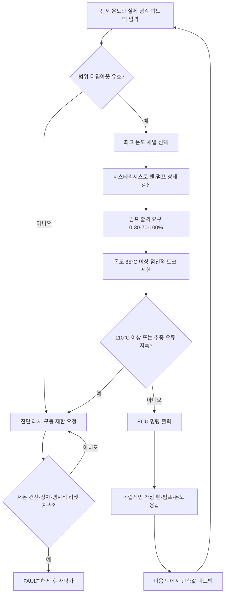

# TraceBack Thermal v11 — 교육용 열관리 제어 계약

> **적용 범위:** 단일모터 RWD BEV의 단순화된 팬·펌프·온도 보호 모델. 양산 ECU, 실제 열설계 및 기능안전 검증에 사용 금지.
>
> **기존 코드 재사용:** `src/campaign/vehicleSystems.ts`의 `SystemInput`/`SystemOutput`와 구동 명령, `src/campaign/vehicleArchitecture.ts`의 열관리 계층, `src/engineering/actuator-lab`의 개념 예제를 참고한다. 종전 `stepVehicleSystems()`는 변경하지 않는다.

## 1. 실행 경로와 소유권

- **신규 ECU 순수 함수:** `src/campaign/thermalModel.ts`의 `stepThermal(previousState, input, dtSec)`
- **독립 교육용 장치·열 응답:** `stepThermalPlant(previousPlant, command, dtSec, conditions)`
- **차량 모델 연결:** `stepVehicleSystemsWithThermal(previousVehicle, vehicleInput, previousThermal, thermalObservations, dt, bms?)`
- **입력 어댑터:** `thermalInputFromVehicle()`; 측정 팬/펌프 응답을 생성하지 않고 호출자가 전달해야 한다.
- `stepVehicleSystemsWithThermal()`는 **선택형 어댑터**다. 기존 `stepVehicleSystems()`/`stepVehicleSystemsWithEps()`/BMS/HV/기어/구동/제동 인터페이스는 유지된다.
- **주의:** 새 어댑터는 기존 `stepVehicleSystems()`의 구동 명령과 냉각 상태만 보강하며, *새 `stepPropulsion()` 엔진과 한 루프에서 자동 연계된 것은 아니다*. 전체 시스템의 공통 실행 순서는 후속 통합 작업에서 정의해야 한다.

## 2. 신호 계약

| 구분 | 이름 | 단위/형식 | 의미 |
|---|---|---|---|
| 측정 | motorTempC, inverterTempC, batteryTempC, coolantTempC, ambientTempC | °C | 독립 측정 온도. -40~160 범위 |
| 측정 | temperatureSignalAgeMs | ms | 모든 온도 채널의 공통 교육용 신선도. 0~100 포함 |
| 피드백 | fanObservedOn | Boolean | 팬 실제 ON 관측. ECU 명령이 아님 |
| 피드백 | pumpObservedPct | % | 펌프 실제 출력 0~100 |
| 피드백 | feedbackAgeMs | ms | 실제 장치 응답의 신선도 0~100 포함 |
| 외부 상태 | systemEnabled | Boolean | 열관리 운용 허용 |
| 외부 상태 | vehicleSpeedKmh | km/h | 정지 후 리셋 가능 여부 |
| 외부 이벤트 | resetRequested | Boolean | 명시적 고장 복귀 요청 |
| ECU 상태 | fanLatched, pumpLatched | Boolean | 히스테리시스의 이전 상태 |
| ECU 명령 | fanOn | Boolean | 팬 구동 명령 |
| ECU 명령 | pumpRequestPct | % | 펌프 출력 요청, 0/30/70/100 |
| ECU 제한 | torqueLimitScale | 0~1 | 구동 토크 출력의 교육용 제한 비율 |
| ECU 보호 | shutdownRequested | Boolean | 구동 제한/차단 요청. 실제 HV 접촉기 개방은 아님 |
| 진단 | fault | null/오류 코드 | 고장 래치 |
| 피드백 상태 | ThermalPlantState | °C, %, Boolean | 가상 팬·펌프와 온도들의 **실제 응답 모델** |

기본 `dtSec=0.02`초(20ms), 허용 범위 0<dt≤0.1초. 상태기·장치 모델은 동일한 dt에서 각기 한번씩 호출한다.

## 3. 흐름

## 4. 교과서적 핵심 로직과 임시 보정값

- 팬 **OFF → ON**: `max(motor, inverter, battery, coolant) ≥ 50°C`.
- 팬 **ON → OFF**: 같은 최고온도 `≤45°C`. 그 사이에서는 **이전 상태 유지**.
- 펌프 **OFF → ON**: `≥40°C`; **ON → OFF**: `≤35°C`. ON 상태에서 요청 출력은 `≥75°C:100%`, `≥55°C:70%`, 그 외 `30%`.
- 온도 기반 토크 제한: 최고온도 `≤85°C`: 100%, `85~105°C`: 선형으로 20%까지 축소; `≥110°C`: `CRITICAL_OVERTEMP` 고장 래치 및 `shutdownRequested=true`, `torqueLimitScale=0`.
- 팬/펌프 **명령-관측 불일치**가 0.6초 이상 지속될 때 진단 확정. 순간적인 기동 지연은 고장 아님.
- 정차(≤0.5km/h), 정상 신호, 최고온도 ≤45°C, 명시적 리셋이 0.5초 이상 지속되면 고장 래치를 해제. **이 예시는 실제 안전 정책이 아니다.**
- 고장 발생 시 토크 제한 요청을 내지만 이미 발생 중인 실제 토크나 HV 접촉기의 물리 상태가 즉시 0이 된다고 가정하지 않는다.
- 센서·피드백이 invalid인 경우 임의로 정상 가동을 가정하지 않으며, 보호 제한을 요청한다.

## 5. 온도 장치·물리 모델

`stepThermalPlant()`는 냉각팬 고착/펌프 고착/출력 저하를 따로 주입할 수 있다. 팬 ON·펌프 출력에 비례한 **냉각 경향**과 외부 발열을 이용해 온도가 변한다. 발열 및 냉각 계수는 °C/s에 기반한 임의 교육용 상수이며, **실제 냉각수 회로·열용량·배터리 열전달을 재현하지 않는다**. 온도가 물리적으로 얼마나 오래 걸려 상승하는지 판단하는 근거로 사용하지 않는다.

## 6. 게임에 노출하는 문장형 블록

**사용자가 조작할 후보 (4~6개로 제한):**
1. `온도 센서값이 정상 범위와 수신 시간 안에 있나?`
2. `팬 OFF일 때 50°C 이상이면 ON`
3. `팬 ON일 때 45°C 이하이면 OFF`
4. `그 사이라면 이전 팬 상태 유지`
5. `팬 ON 명령인데 실제 팬이 돌지 않는가?`
6. `과열 시 구동 토크 상한을 낮춘다`

**내부 자동 실행:** 최고온도 집계, 세부 펌프 보정, 시계열 적분, 팬/펌프 장치 응답, 고장 타이머, 리셋 확인, 물리 응답 계산.

**중요:** 이번 v11은 위 판단을 실제로 계산하는 모듈이지, 기존 Stitch 로직 작업대에서 이 블록을 편집하면 `stepThermal()` 로직이 자동 변경되는 편집기까지 연결한 것은 아니다. 시나리오별 가변 블록 그래프 연계는 별도 통합 작업.

## 7. 테스트 계획 및 현황

| 분류 | 검증 | 결과 |
|---|---|---|
| 정상 | 차가운 상태, 팬/펌프 기동·정지 | 통과 |
| 경계 | ON/OFF 경계값, 신호 신선도 100ms | 통과 |
| 상태 | 히스테리시스 데드밴드, 펌프 단계 전환 | 통과 |
| 보호 | 85°C/95°C/105°C 출력 제한, 110°C 고장 | 통과 |
| 진단 | 센서 invalid, 팬/펌프 응답 고착, 신호 stale | 통과 |
| 플랜트 | 실제 동작 지연, 냉각 경향, 장치 고착 | 통과 |
| 복귀 | 리셋 제한, 조건 지속 확인 | 통과 |
| 호환 | 기존 `stepVehicleSystems()` 변화 없음 | 통과 |

`node --experimental-strip-types --test tests/thermal-educational.test.mjs` — **25/25 통과**.
전체 `tests/*.test.mjs` — **314 통과, 4개 파일 실행 실패(모듈 미설치)**.
`tsc --noEmit --skipLibCheck --target es2022 --module nodenext --moduleResolution nodenext --allowImportingTsExtensions src/campaign/thermalModel.ts src/campaign/vehicleSystems.ts` — **통과**.
전체 앱 빌드/브라우저 플레이 검증 미실행.

## 8. 한계 / 후속 작업

1. 배터리·모터·인버터의 실제 열원 및 냉각 회로 분리 모델 없음(최고 온도만 대표값으로 사용).
2. 펌프·팬 출력은 간략한 단계형 제어이며 실제 PID나 전동식 냉각밸브 제어는 없음.
3. 정상 주행 중의 SW 로직 교정·OTA 복귀는 이 ECU 고장 래치 정책과 별도로 게임 세계관에서 설계해야 함. 여기서는 주행 중 리셋을 허용하지 않음.
4. 기존 `vehicleSystems.ts`의 기본 단순 열관리 계산과 별도 `actuator-lab` 열관리 예제는 남겨뒀다. 최종 게임에서는 새 열관리 모듈이 **열관리 판단의 유일한 기준**이 되도록 통합 계획 필요.
5. `stepVehicleSystemsWithThermal()`는 기존 단순 차량 모델의 온도 제한을 제거하고 새 제한값을 적용하지만, 고급 `stepPropulsion()`·`stepBraking()` 등 다른 선택형 실행기와 **자동 통합되지 않는다**.
6. 실제 출력 토크 피드백과 차량 이동·추격 거리 연동 미구현. 요구사항과 실측 열거동을 검증하는 실제 HIL 시험이 아님.
