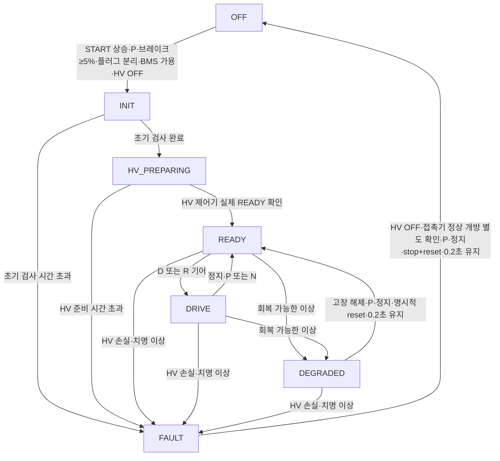

# Vehicle Mode (VCU) 교육용 상태 제어 계약 — v6

## 목적·범위
이 코드는 **차량 운용 상태 소유권**을 VCU에 부여하는 교육용 결정론적 상태기다. 개별 BMS/HV ECU 내부 로직, 접촉기 물리 동작, 게임 UI 상태를 대신 구현하지 않는다. 현장 차량 제어·정비·기능안전 검증에 사용해서는 안 된다.

## 상태 흐름

- `OFF → INIT`은 START 이벤트의 **상승 순간**에서만 가능하며, 버튼 누른 상태 유지/중복 요청은 새로운 시작 이벤트로 인정하지 않는다.
- `INIT → HV_PREPARING`은 VCU가 HV 준비를 *요청*한다는 뜻이고, 접촉기가 실제로 닫혔음을 의미하지 않는다.
- `HV_PREPARING → READY`는 독립된 HV 제어기의 `hvReady` 피드백에 의존한다. 시간이 흘렀다는 이유만으로 READY가 되지 않는다.
- `READY → DRIVE`는 D 또는 R 상태에서 가능하지만, **기존 주행 식물 모델은 D 전진 토크만 지원**한다. R 기어의 실제 음의 토크 출력은 구현하지 않았다.
- `DEGRADED`는 가용 구동 명령을 정상의 **25%**로 제한하는 교육용 예제 정책이다. 25%가 실제 차량의 안전한 최저 주행 속도나 기능안전 요구를 뜻하지 않는다.
- `DEGRADED → READY`는 외부 고장 해제, 정지, 기어 P, reset, 안정 시간의 조건을 필요로 한다. 주행 중 고장 해제 즉시 정상 토크로 복귀하지 않는다.
- `FAULT`는 래치된다. HV 측 고장은 HV 자체 상태기를 먼저 복귀시켜야 한다. 차량 상태기 reset만으로 HV의 접촉기 피드백을 바꾸지 않는다.

## 입력 인터페이스 (`VehicleModeInput`)

| 변수 | 단위 / 타입 | 의미 | 출처 |
|---|---|---|---|
| `startEdge` | bool | START 입력 상승 이벤트, **레벨 아님** | 운전자/버튼 로직 |
| `stopEdge` | bool | 운전자 정지 요청 이벤트 | 운전자/버튼 로직 |
| `resetRequested` | bool | 명시적 고장 reset 요청 | 복구 절차 |
| `gear` | enum P/N/D/R | 관측된 기어 상태 | 기어 제어기 |
| `brakePct` | 0..100 % | 제동 페달 측정 | 센서 |
| `speedKmh` | km/h, ≥0 | 차속 측정 절댓값 | 차량 상태 |
| `plugged` | bool | 충전 플러그 연결 | 인터록 |
| `signalAgeMs` | ms | VCU 입력 최신성 | 수신기 |
| `initChecksOk` | bool | 다른 ECU 초기검사 완료 | 진단 집계 (추상화) |
| `hvMode` | OFF/PRECHARGE/CONTACTOR_CLOSE/HV_READY/FAULT | 독립 HV 제어기 현재 상태 | HV ECU |
| `hvReady` | bool | 독립 HV ECU READY 판정 | HV ECU |
| `bmsMode` | NORMAL/LIMITED/FAULT/SHUTDOWN_REQUEST | 배터리 보호 상태 | BMS |
| `packAvailable` | bool | BMS가 방전 사용을 허용하는지 | BMS |
| `recoverableFault` | bool | 제한 운행 가능한 고장 존재 | 외부 진단/안전 정책 (추상화) |
| `criticalFault` | bool | 운행 허용 불가로 판정된 고장 | 외부 진단/안전 정책 (추상화) |

## 출력 인터페이스 (`VehicleModeResult`)

| 변수 | 의미 | 주의 |
|---|---|---|
| `state.mode` | VCU 운용 상태 | UI 화면 상태와 독립 |
| `requests.hvStartPermit` | HV 준비 요청 | 접촉기 실제 닫힘 아님 |
| `requests.hvStopRequested` | HV 정지 요청 | 접촉기 개방 *명령*, 실제 개방 여부 별도 피드백 |
| `requests.driveEnable` | VCU 구동 허용 | 차량 모델의 D 기어·제동 인터록이 추가로 적용됨 |
| `requests.torqueLimitScale` | 정규화된 VCU 전력 제한 [0..1] | 단위 없는 교육용 비율, Nm 아님 |
| `permissions.vehicleReady` | VCU, HV, BMS의 READY 합의 | 고전압 회로 실측을 이 값으로 대체 금지 |
| `permissions.restrictedOperation` | 제한 운용 표시 | 안전한 속도 유지 자동제어가 아님 |
| `diagnostics.transition` | 상태 이전/이후 | Entry/Exit 전이 기록 |
| `diagnostics.fault` | 래치 고장 코드 | 실제 DTC 체계 아님 |
| `feedback.*` | 입력된 BMS/HV/기어 상태의 스냅샷 | 관측값과 ECU 명령을 혼동하지 말 것 |

## 실행 순서·시간
- 기본 실행 주기 `dt=0.02초(20ms)`, 허용 `0 < dt ≤ 0.1초`.
- `elapsedSec` = 현재 상태 체류 시간, `recoverySec` = 안정된 복귀 조건 연속 유지 시간.
- 기본 캘리브레이션: `INIT_TIMEOUT=1초`, `HV_TIMEOUT=3초`, `RECOVERY=0.2초`, `STOP_SPEED≤0.5km/h`, `SIGNAL_AGE≤100ms`.
- 전부 교육용 예시값. 특정 OEM 기준 아님.

## 호출/통합 API
- 신규 상태기 `stepVehicleMode(previous, observations, dt)`.
- 기존 `stepVehicleSystems()`·`stepVehicleSystemsWithBms()`·`stepVehicleSystemsWithHv()`·`stepVehicleSystemsWithBmsAndHv()`는 변경하지 않음.
- 선택 연결 `stepVehicleSystemsWithMode(...)`는 VCU 운용 허용을 기존 구동 계산에 추가로 적용한다.
- 선택 연결 `stepVehicleSystemsWithBmsHvAndMode(...)`는 BMS→VCU 시작 명령→HV 상태기→VCU 주행 허용을 경량 통합한다. **HV 실측 피드백은 호출자가 따로 넣어야 하며, `stepHvPlant`로 교육용 액추에이터 모델을 별도로 실행할 수 있다.**
- 최신 통합 호출에서의 VCU 시작 명령 생성에는 이전 HV 상태(지난 tick)를 사용하고, 현재 tick HV 결과로 최종 주행 허용을 재평가한다. 이산시간 1-cycle 분리를 의도한 것.
- 실제 물리 현상과 연결된 전체 게임 런타임 통합은 아직 하지 않음.

## 게임 문장형 로직 블록: 플레이어 노출 추천
1. `START 상승 신호가 들어왔는가?`
2. `P 기어 AND 브레이크 ≥ 5% AND 충전 플러그 분리`
3. `BMS 전력 사용 허용 AND 초기 검사 완료`
4. `HV 준비 완료 피드백이 확인되었는가?`
5. `D/R 기어이면 주행 허용`
6. `제한 가능한 고장 → DEGRADED / 치명적 고장 → FAULT`
7. `고장 해제 후 정지·P·리셋·안정 시간 확인`

자동 실행: dt 처리, 타임아웃 누적, 경계값 비교, 상태 이력, 방전 전력 한계 및 실제 접촉기 플랜트 계산. 플레이어는 **선택된 사건 관련 블록만** 조작하며 게임의 메모판·로직 복원·쌍둥이 시험대 화면은 변경하지 않는다.

## 남은 의도적인 단순화 / 판단 유보
1. `initChecksOk`, `recoverableFault`, `criticalFault`의 **검출 정책은 외부에서 전달받는 추상화된 상태**이며, 실제 고장 분류·진단 의사결정은 미구현.
2. HV 시스템의 상세 contactor 정합성은 `hvModel.ts`가 담당하며, 일부 기존 간이 HV 허용 모델은 하위호환용으로 여전히 존재한다. 단일 기준 모델 전환은 향후 통합에서 해야 함.
3. `R` 운용 상태는 구분하지만 후진 구동 플랜트는 미지원.
4. `DEGRADED`의 25% 출력 제한은 기능안전 분석으로 정당화된 값이 아니며, 게임의 자동 저속 주행(18km/h) 기능과 동일하지 않다.
5. 현재 복구는 **정차 + P + 수동 reset** 조건으로 설계되었다. 게임이 요구하는 '달리면서 진단→OTA→즉시 정상 주행'은 이 모델과 충돌한다. **안전성 관점에서 무단으로 완화하지 말 것.** 추후 게임에서 별도 복구 정책을 설계·승인해야 한다.
6. `OFF` 정지 명령이 의미하는 실제 HV 접촉기 개방 및 잔류전압 방전은 HV plant가 확인해야 한다. VCU 모델은 직접 개방을 가정하지 않는다.
7. 기존 시스템의 구동 역학은 정규화된 토크 모델이고 실제 안전성 등급 및 HIL 검증을 제공하지 않는다.
