# 플레이어 관점 흐름 점검과 단순화 제안 (2026-11-15)

사용자 검토(2026-11-15)의 3·4·5번 요청에 대한 답입니다. 현재 화면을 1600x900에서 직접 캡처해(`docs/captures-2026-11-15/`) 단계별 세부 구성, 문제 원인, 단순화 제안을 정리했습니다. **제안은 모두 승인 전입니다.** 승인되면 7절 순서로 구현합니다.
캡처 기준 사건은 구동(가설 2개가 시험 대상)이고, 다른 사건도 같은 화면 구조입니다.

## 1. 현재 흐름: 단계별 세부 구성 (캡처 포함)
레벨 선택 → 레이스 → 고장 → STEP01 정비소 → STEP02 도미노 → STEP03 퍼즐 → STEP04 실험대 → 수리 → 레벨 선택.
화면 한 장에 항상 있는 공통 요소: 상단 진행 바, 단계 안내 두 줄과 세부 단계 칩, 미션 바, 가운데 작업 영역, 하단 영역, 우측 패널, 우하단 "다음" 버튼.

### 1.1 레벨 선택 (1화면)
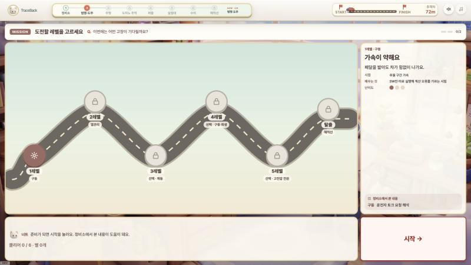
레벨 6개 노드 중 하나를 골라 오른쪽 카드에서 요약을 보고 시작합니다. 이번에 노드가 움직이던 문제는 고쳤습니다(선택 때 크기 변화 제거).

### 1.2 STEP01 정비소 (세부 5단계, 화면 5종)
| 세부 단계 | 화면 | 플레이어가 하는 일 | 화면에 동시에 있는 것 |
|---|---|---|---|
| 1 차량 전체 | 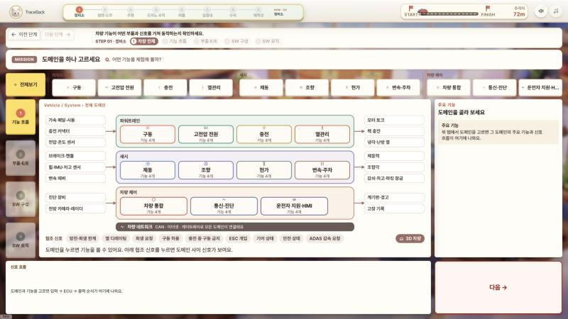 | 도메인 11개 중 하나를 고름(그룹 3개로 묶인 도식) | 도메인 11개 버튼 + 도식 + 협조 신호 칩 9개 + 층 탭 4개 + 우측 패널 + 하단 안내 |
| 2 기능 흐름 | 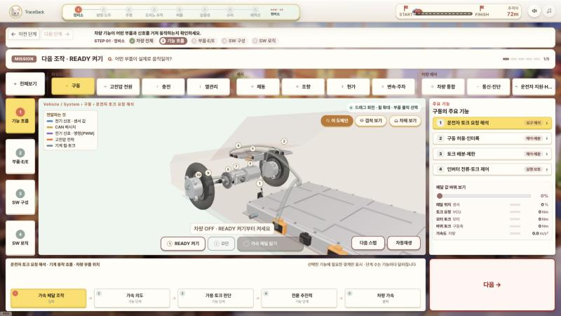 | 기능 4개 중 하나를 고르고 3D 차에서 조작(READY 켜기, 페달 밟기) | 3D + 기능 카드 4개 + 값 표시 6줄 + 하단 5단계 흐름 + 조작 버튼 5개 + 상단 도메인 11개 |
| 3 부품·E/E | 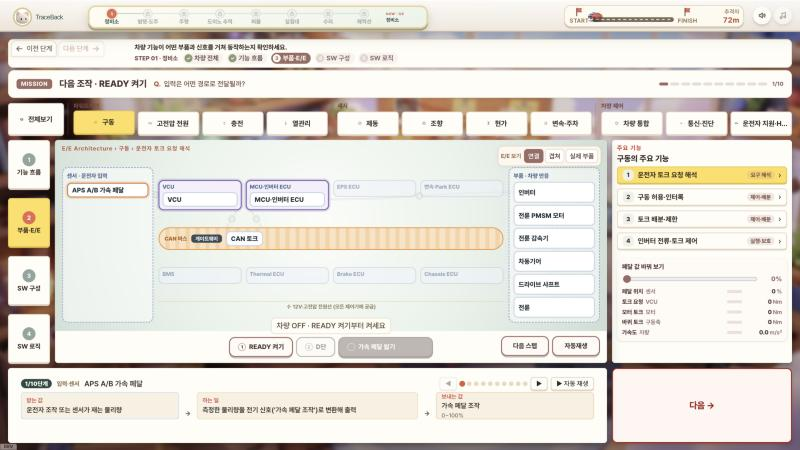 | 센서·ECU·CAN·부품 구조를 보고 단계별로 넘김 | E/E 도식 + 부품 목록 + 단계 설명 3칸 |
| 4 SW 구성 | 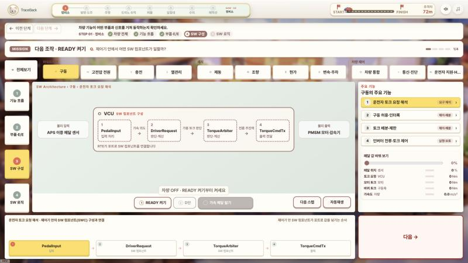 | VCU 안의 SW 컴포넌트 흐름을 봄 | SWC 도식 + 하단 흐름 |
| 5 SW 로직 | 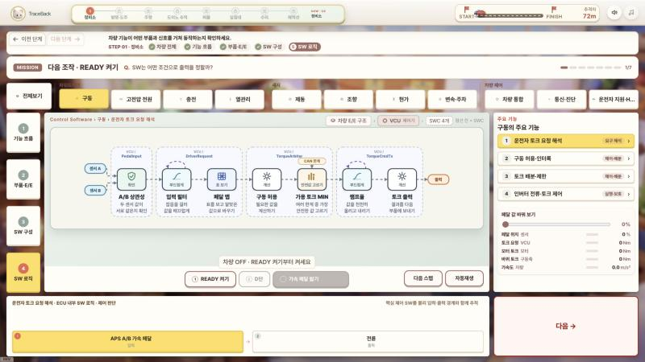 | SW 블록의 입력·계산·출력을 봄 | 블록 도식 8개 + 하단 흐름 |
한 화면에 읽을 것이 가장 많은 단계입니다. 도메인 11개 × 기능 4개 × 4층이라 선택지가 많고, 모든 화면에서 위쪽 도메인 11개 버튼이 계속 보입니다.

### 1.3 STEP02 도미노 추적 (세부 3단계, 실제 화면 상태 5종 + 반복)
| 세부 단계 | 화면 | 플레이어가 하는 일 | 문제 |
|---|---|---|---|
| 1 증상 확인 | 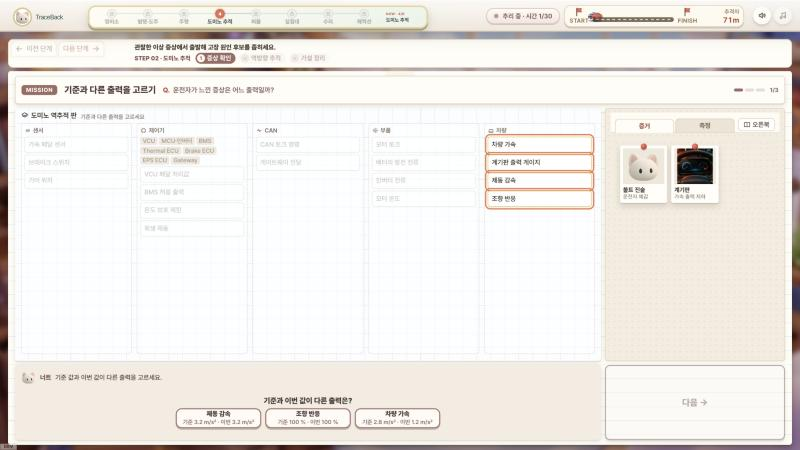 | 하단의 글자 카드 3장 중 "기준과 이번 값이 다른 출력"을 고름 | 카드가 글자뿐이고 "기준/이번" 수치가 일반 글자라 읽기 어려움. 폴라로이드 그림은 우측 패널에만 있음 |
| 2 역방향 추적 (시작) | 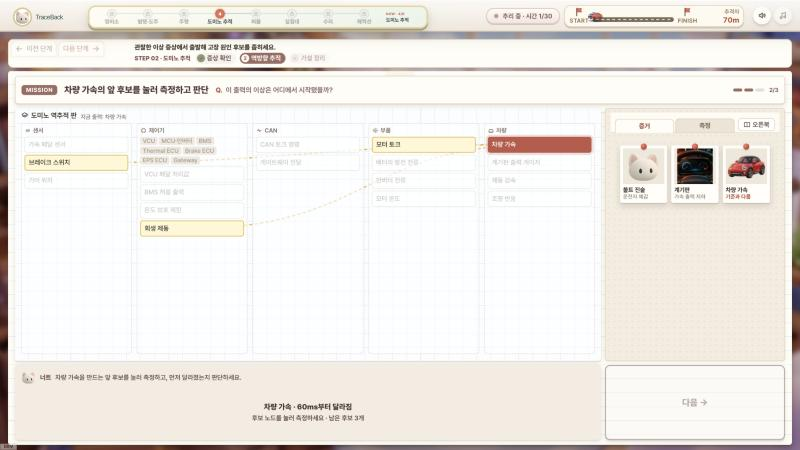 | 판의 후보 노드를 눌러 재 봄 | 무엇을 눌러야 하는지(후보 3개)와 "먼저 달라졌는지 판단"이라는 규칙이 화면에 없음 |
| 2 역방향 추적 (판정, **노드마다 반복**) | 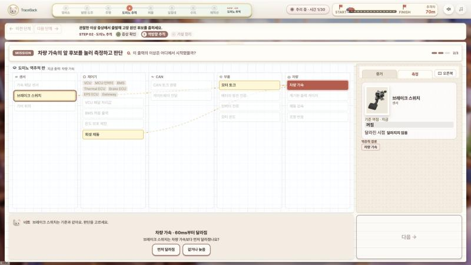 | "먼저 달라짐 / 같거나 늦음" 두 버튼으로 판정. 이 판정이 후보마다 반복됨 | 질문 첫 줄 "차량 가속 · 60ms부터 달라짐"과 둘째 줄 질문이 어떤 기준에서 묻는지 모호 |
| 2 → 의심 구간 | 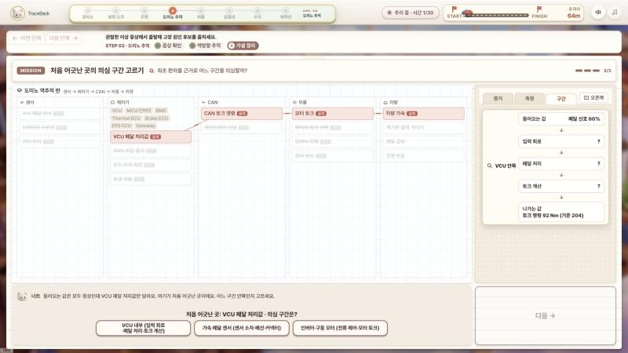 | 첫 편차를 찾은 뒤 의심 구간 3지선다 | 제목 "처음 어긋난 곳: ○○ · 의심 구간은?"이 이해되지 않음. 우측에 갑자기 "구간" 탭이 열림 |
| 3 가설 정리 | 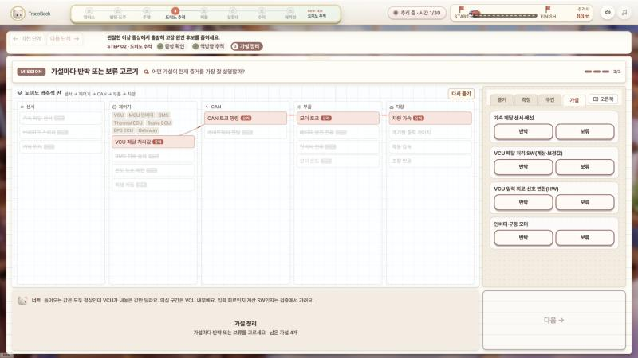 | **우측 패널**에서 가설 카드마다 "반박/보류"를 누름 | 하단이 아니라 우측에서 고르는 점이 앞 단계와 불일치. "반박/보류"가 무엇에 대한 것인지 불명확 |
우측 패널은 탭 4개(증거·측정·구간·가설)입니다. 각 역할과 켜지는 시점은 2절 표에 정리했습니다.

### 1.4 STEP03 퍼즐 (세부 3단계, 화면 3종)
| 세부 단계 | 화면 | 플레이어가 하는 일 | 문제 |
|---|---|---|---|
| 1 정상 기준 구성 | 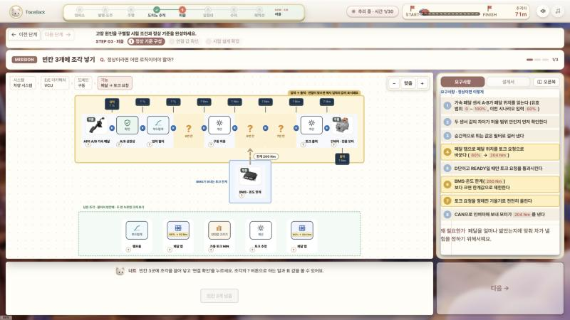 | 아래 남은 조각을 끌어 빈칸 3개에 넣음 | 앞 단계에서 세운 가설과 이 퍼즐이 어떻게 이어지는지 설명이 없음. 요구사항(우측)과 조각을 함께 읽어야 함 |
| 2 연결·값 확인 | 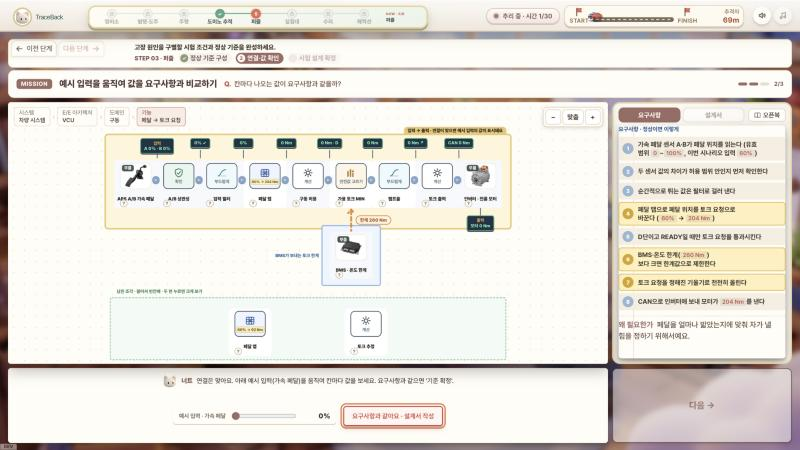 | 슬라이더로 예시 입력을 움직여 값 확인 후 "요구사항과 같아요" | 값이 판 위에 작게 표시됨 |
| 3 시험 설계 확정 | 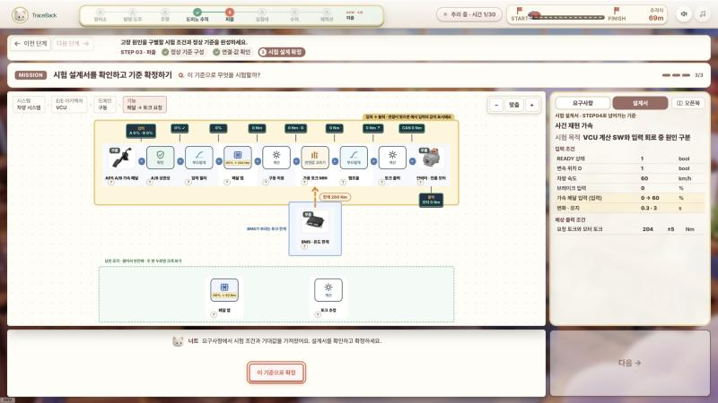 | **우측 패널**의 시험 설계서를 읽고 "이 기준으로 확정" | 설계서가 좁은 패널에 표로 있어 눈에 안 들어옴. 이 시험을 왜 하는지, 입력·출력이 정비소 어느 영역인지 연결이 없음 |

### 1.5 STEP04 실험대 (세부 4단계, 화면 상태 8종, **가설 수만큼 반복**)
| 세부 단계 | 화면 | 플레이어가 하는 일 | 문제 |
|---|---|---|---|
| 1 시험 설계 | 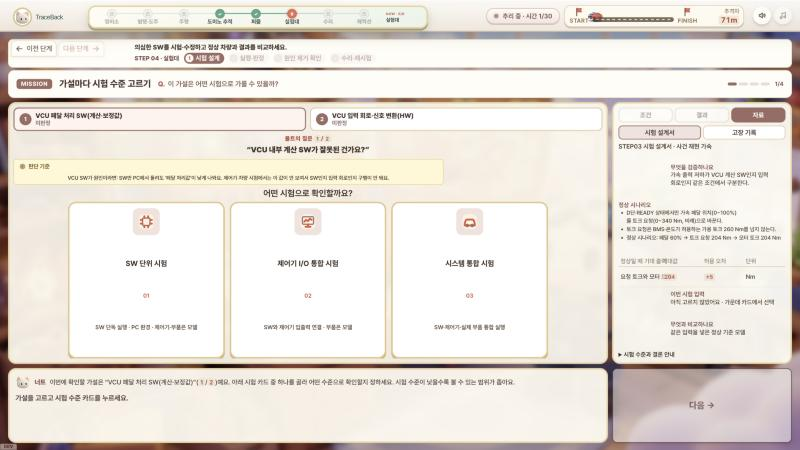 | 가설 탭(2개)마다 시험 수준 카드 3장 중 하나를 고름 | 가설이 왜 이 순서로 나열됐는지, 어느 가설부터 해야 하는지 안내 없음 |
| 2 실행·판정 (준비) | 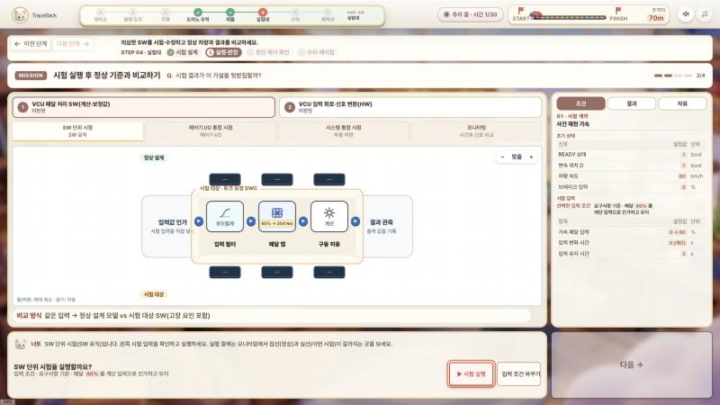 | 시험 수준 탭 4개 중 하나에서 "시험 실행" | 탭이 수준 4개 + 우측 탭 3개 + 우측 하위 탭 2개로 많음 |
| 2 실행·판정 (판정) | 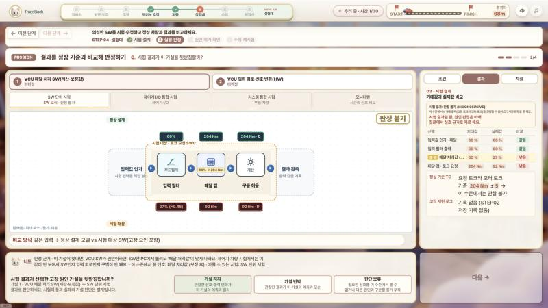 | 결과 도장("판정 불가")과 신호 비교를 보고 "지지/반박/보류" 선택 | 결과 도장과 가설 판단이 별개라는 설명이 길고, 같은 화면에 정보가 너무 많음 |
| 3 원인 제거 확인 (원인 고르기) | 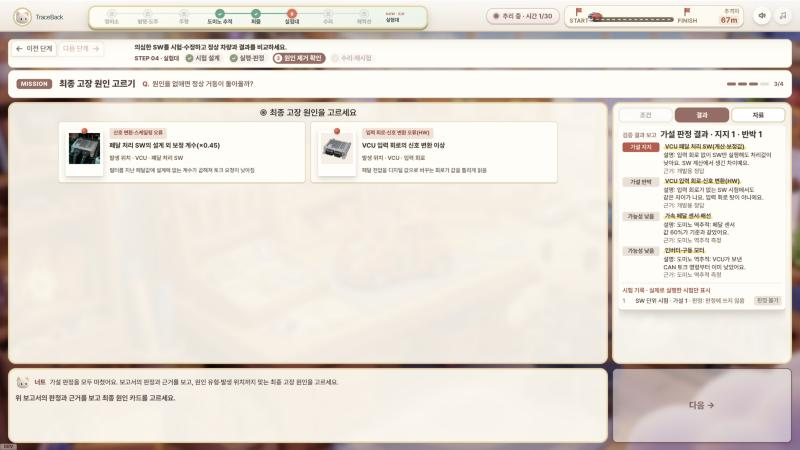 | 최종 원인 카드를 고름 | 앞 단계 판정이 우측에 요약돼 있고 근거가 글자 위주 |
| 3 원인 제거 확인 (비교 실행) | 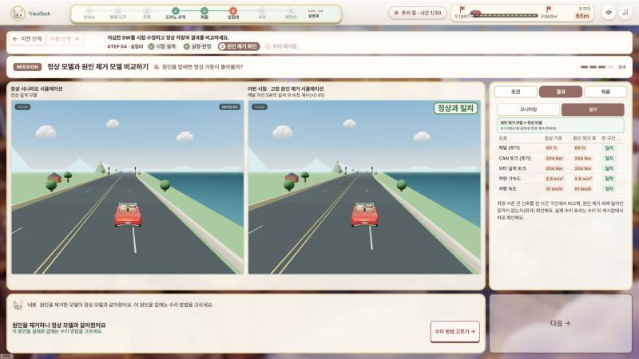 | 정상 모델과 원인 제거 모델을 동시 실행해 비교 | 앞의 "실행·판정"과 모양이 비슷한 또 한 번의 실행 |
| 4 수리 (수리 고르기) | 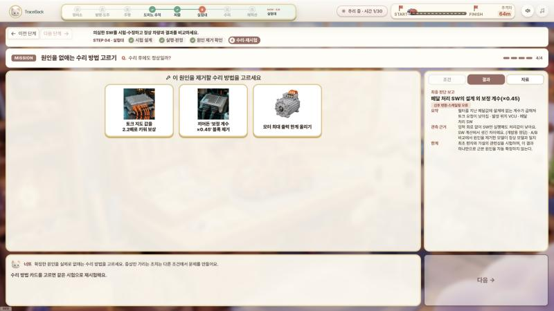 | 수리 카드 3장 중 선택 | |
| 4 재시험 | 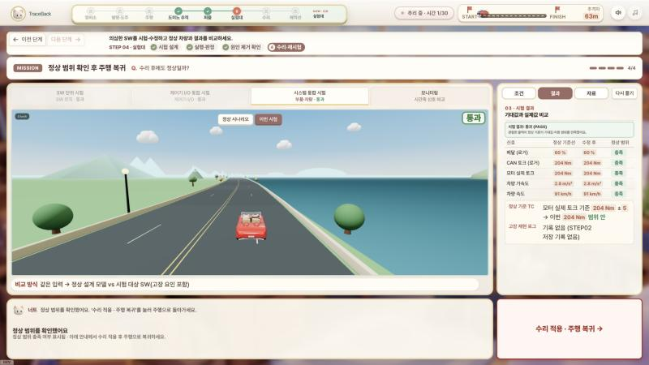 | 수리 후 같은 시험을 다시 실행해 통과 확인 | 또 한 번의 실행·비교(세 번째) |
**반복 횟수(구동 사건, 가설 2개 기준):** 시험 수준 고르기 2회 + 시험 실행 2회 + 판정 2회 + 원인 고르기 1회 + A/B 실행 1회 + 수리 고르기 1회 + 재시험 1회 = **10번의 선택·실행**. 그중 "실행하고 결과 비교"는 3번(시험, A/B, 재시험)이고 화면 모양이 거의 같습니다.

## 2. 문제의 원인 (플레이어가 어렵게 느끼는 이유)
1. **한 화면의 정보 양이 많습니다.** 정비소는 도메인 11 + 기능 4 + 층 4 + 협조 신호 9를 한꺼번에 보여 줍니다. 도미노·실험대도 노드 20여 개, 탭 4~9개가 동시에 보입니다.
2. **영역의 역할이 단계마다 다릅니다.** 증상 확인은 하단 선택, 가설 정리는 우측 선택, 구간 선택은 하단 선택입니다. 우측 패널이 "기록"인지 "입력 공간"인지 일정하지 않습니다.
3. **지금 무엇을 하는지, 다음에 무엇을 하는지 말해 주지 않습니다.** 단계 전환 때 "여기까지 했고 이제 이걸 합니다"가 없고, 질문 제목이 결과 용어("처음 어긋난 곳 · 의심 구간은?")로 되어 있습니다.
4. **같은 말이 단계마다 다른 뜻으로 쓰입니다.** "반박/보류"는 도미노에서는 "후보에서 뺄까 말까"이고 실험대에서는 "시험 결과 판단"입니다.
5. **그래픽 중심이던 정보가 글자와 수치로 바뀌었습니다.** 폴라로이드 카드는 우측 패널로 밀리고 하단 선택은 글자 버튼입니다. 수치("기준 2.8 · 이번 1.2")가 일반 글자라 눈에 안 띕니다(규칙상 수치는 코드 표기).
6. **가설 수만큼 마지막 검증이 반복됩니다.** 실행·판정이 가설마다 돌고, 그 뒤에도 비슷한 실행이 두 번 더 있습니다.

### 우측 패널 탭의 현재 역할과 켜지는 시점 (질문 답변)
| 탭 | 지금 보여 주는 것 | 켜지는 시점 | 평가 |
|---|---|---|---|
| 증거 | 폴라로이드(볼트 진술, 계기판, 확인한 노드 사진) | 처음부터 | 기록 성격. 하단과 역할이 겹치지 않음 |
| 측정 | 방금 누른 노드의 기준/지금 값과 달라진 시각 | 노드를 눌렀을 때 | 하단 판정 질문의 근거인데 위치가 떨어져 있음 |
| 구간 | 의심 구간 선택 때 VCU 안쪽(들어오는 값 → 입력 회로?·페달 처리?·토크 계산? → 나가는 값) | 의심 구간 단계 | **정답을 푸는 단서가 아니라 구간 안쪽을 보여 주는 설명**인데 왜 보는지 안내가 없음 |
| 가설 | 가설 카드 4개와 "반박/보류" 버튼 | 가설 정리 단계 | **입력 공간**이라서 나머지 탭(기록)과 성격이 다름 |
→ 우측 패널은 "기록과 참고 전용(읽기)"으로 통일하고, 선택은 항상 하단에서 하도록 3절에서 제안합니다.

## 3. 단순화 제안

### 3.1 공통 원칙 (모든 단계)
1. **한 화면, 한 결정.** 플레이어가 한 번에 내리는 선택은 하나뿐이고, 그 선택지는 3개 이하입니다.
2. **영역 역할 고정.** 상단 = "지금 할 일" 한 줄(디렉션), 가운데 = 보고 만지는 그림, 하단 = 선택 입력(항상 여기서만 고름), 우측 = 지금까지 모은 기록과 참고(읽기 전용). 선택 입력이 우측으로 가지 않습니다.
3. **점진 공개.** 지금 단계에 필요한 것만 보이고 나머지는 접습니다. 이전에 한 것은 우측 기록으로 쌓입니다.
4. **디렉션 3요소.** 모든 단계 전환에 (a) 방금 한 일 (b) 이제 할 일 (c) 하는 방법을 한 번에 보여 줍니다(예: "첫 편차를 찾았어요(a). 이제 이 편차를 만든 위치를 의심 구간으로 좁혀요(b). 아래 3곳 중 하나를 고르세요(c)").
5. **수치는 코드 표기**하고 기준/이번 값을 색(기준=회색, 이번=붉은 계열)으로 구분합니다.
6. **용어 통일.** 한 단어는 한 뜻만 씁니다(8절).

### 3.2 정비소: 입구를 3그룹으로 (제안 평가: **좋은 방향**)
- 사용자 아이디어(파워트레인 / 섀시 / 차량 제어 세 그룹으로 먼저 들어가 하위 도메인을 여는 구조)를 채택합니다. 현재 도식이 이미 이 3그룹이라 구현 부담이 작습니다.
- 흐름: ① 그룹 3개 카드만 보임 → ② 그룹을 누르면 그 그룹의 도메인 3~4개만 보임(나머지는 흐림) → ③ 도메인을 누르면 기능 4개 → ④ 기능을 누르면 4층 중 "기능 흐름"부터 시작.
- 층은 4개를 한꺼번에 주지 않고 **기본 2개(기능 흐름, 부품·E/E)**를 먼저 열고, "SW 구성·SW 로직"은 "더 깊이 보기"로 이어 엽니다(사건이 SW 로직이어야 필요).
- 위쪽 도메인 11개 버튼 줄은 없애고(그룹 선택으로 대체) 화면 위쪽에 현재 위치만 한 줄로 보여 줍니다("차량 › 파워트레인 › 구동 › 토크 요청").
- 정비소 필수 체험은 "사건과 관련된 기능 1개의 기능 흐름 + 부품·E/E"로 줄이고 나머지는 선택(오픈북과 같은 자료)으로 둡니다.
- 효과: 처음 화면의 선택지가 11개 → 3개, 한 화면에 보이는 정보가 약 1/4.

### 3.3 도미노 추적 재설계 (제안: **"청기백기" 방식**)
**게임의 규칙을 화면 첫 장에서 한 번 알려 줍니다(규칙 카드).**
> 운전자가 느낀 이상(출력)에서 시작해, 그 출력을 만든 부품 신호를 **거꾸로** 따라가며 **처음 어긋난 곳**을 찾아요.
> 후보 신호가 하나씩 나옵니다. 그 신호가 **이상이 있고 이 출력보다 먼저 달라졌다면 [←] 영향을 줬어요**, **정상이거나 나중에 달라졌다면 [→] 영향을 주지 않았어요**를 눌러요.
> 영향을 준 신호는 다음 후보를 찾는 기준이 돼요. 더 이상 먼저 달라진 후보가 없으면 거기가 **첫 편차**예요.

**화면 구성(안):**
- 가운데: 폴라로이드 카드(사진 + 라벨 + 기준/이번 값 코드)가 한 장씩 크게 나옵니다. 기존 우측 증거 폴라로이드를 하단 선택 영역으로 되돌립니다(요청하신 "폴라로이드 보기" 복귀).
- 하단: 큰 버튼 2개와 키 표시. `[←] 영향을 줬어요`, `[→] 영향을 주지 않았어요`.
- 상단 디렉션 한 줄: "지금 기준 신호는 `차량 가속`이에요. 이 신호에 영향을 줬을 후보를 하나씩 확인해요(3개 중 1번째)."
- 판정 뒤: 결과 해설 한 줄("`브레이크 스위치`는 정상이라 영향이 없었어요")과 진행 표시(후보 1/3).

**BFS 구조 설명 (질문 답변):** 맞습니다. 증상(최종 출력)이 **루트**이고, 후보는 "그 노드에 영향을 줄 수 있는 입력들"입니다. 한 노드의 후보를 모두 판정하면 영향을 준 후보가 **다음 기준 노드**가 되어 한 층 더 거슬러 올라갑니다(한 층씩 넓혀 가는 BFS에 가깝습니다. 한 줄 경로가 아니라 층마다 후보를 모두 확인하기 때문입니다). 후보가 모두 "영향 없음"이면 그 기준 노드가 첫 편차입니다. 화면에는 항상 `현재 기준 신호`와 `판정할 후보 n/m`을 보여 주고, 기준이 바뀔 때 "`모터 토크`에 영향을 준 신호를 찾았어요. 이제 `모터 토크`를 기준으로 거슬러 올라가요"라고 말합니다.

**첫 편차 이후 질문 문구(안):**
- 첫 편차 확인 카드: "첫 편차는 `VCU 페달 처리값`이에요. 입력은 모두 정상인데 이 값부터 달라졌어요."
- 의심 구간 질문: "이 편차가 만들어진 위치로 의심되는 곳은 어디일까요? 아래 3곳 중 가장 의심되는 곳을 고르세요."
- 기존 "구간" 탭(구간 안쪽 보기)은 질문과 같은 화면 가운데에 "선택하기 전에 안쪽 보기" 접이식으로 두어 왜 보는지 분명히 합니다.

**가설 단계 문구(안):**
- 디렉션: "의심 구간은 `VCU 내부`예요. 그렇다면 이 구간에서 편차가 생긴 **원인 후보(가설)**를 세워 볼게요."
- 후보 카드 4장에 **원인 종류 태그**를 붙입니다: `SW 로직`, `SW 설정`, `통신`, `센서`, `HW`(R2의 범주 A~L을 플레이어용 5종으로 묶음).
- 버튼 문구: `[가설 후보에 등록]` / `[후보에서 제외]` (도미노 단계에서 반박/보류 용어 사용 중단). 제외는 "도미노에서 이미 정상으로 확인된 근거가 있는 후보"에만 허용하고, 근거 문장을 카드에 코드와 함께 보여 줍니다.
- 등록된 후보 수(최소 1개, 보통 2개)가 실험대 시작 화면의 가설 목록이 됩니다.

### 3.4 퍼즐: 디렉션과 설계서
- 단계 시작 디렉션(안): "도미노에서 `VCU 내부`를 의심 구간으로 잡고 가설 2개를 세웠어요. 그 구간이 **정상이라면** 어떻게 동작하는지 요구사항을 보고 퍼즐로 맞춰 볼게요. 이 기준이 시험의 비교 기준이 돼요."
- 설계서는 우측 패널이 아니라 **서류철 팝업**으로 되돌립니다(이전 프로젝트 방식). 팝업은 "시험 목적 → 입력 조건 → 기대 출력 → 이 시험이 보는 영역" 4칸으로 구성하고 수치는 코드 표기합니다.
- 확정 전 해설 문장(안): "정상 요구사항대로 정상 로직을 만들었어요. 이제 이 기준으로 아래 조건에서 시험하면 정상 결과가 나와야 해요. 입력은 `페달 0→60 %`, 기대 출력은 `모터 204 Nm ±5`예요."
- **정비소 연결 버튼**: 설계서의 "이 시험이 보는 영역"에 `정비소에서 보기` 버튼을 둡니다. 누르면 해당 도메인·기능·층(시스템 / E/E / 도메인 / 기능 단계)으로 바로 이동해, "이 입력→출력이 어떤 기능의 일부이고 왜 필요한지"를 다시 볼 수 있습니다(돌아오면 퍼즐 상태 유지).
- **퍼즐이 한 번인 이유(질문 답변):** 퍼즐은 가설별이 아니라 **의심 구간의 정상 동작**을 복원하는 단계입니다. 같은 구간 안의 가설들은 모두 이 한 기준을 비교 대상으로 씁니다. 그래서 가설이 여러 개여도 퍼즐은 한 번이고, 가설별 차이는 실험대에서 **시험 수준과 관찰 신호**로 나뉩니다. 이 설명을 퍼즐 시작 디렉션과 실험대 시작 화면에 한 문장씩 넣습니다.

### 3.5 퍼즐 유형 확장: 시스템·E/E·도메인 수준 사건
- 현재 퍼즐은 SW 로직 블록 조립 한 종류입니다. 고장 범주가 통신·E/E 구조·시스템 통합(C, I, K 등)이면 **신호 경로 선택** UI가 필요합니다(R8에 "설계 예정"으로 있던 것).
- 이를 위해 시스템 수준 사건 시트를 만들었습니다: `docs/fault-cases/c04_gear_fallback.md`(변속 위치 통신 타임아웃 폴백, 시스템 통합에서 판정, 후진 거동). UI 사양은 그 시트 7절에 있고, 승인되면 이 사건으로 새 퍼즐 UI(경로 선택)를 구현해 확인합니다.

### 3.6 실험대: 분석과 제안 (질문 5번)
**현재 문제(요약):** 1.5절 표처럼 같은 모양의 "실행·비교"가 3번 있고, 가설마다 수준 선택·실행·판정이 반복되며, 화면 탭이 많습니다. 가설이 여러 개여서 어느 것을 먼저 해야 할지 안내가 없습니다.

**결론: 사용자 제안(더 유력한 가설을 먼저 고르게 하는 방식)을 채택하길 권합니다.** 이유:
- 실무에서도 근거가 가장 강한 가설부터 시험합니다. 가설을 순서대로 모두 시험하는 것은 "시험 계획이 없을 때"의 방식입니다.
- 게임 목표(새 개념 하나를 배우는 것)에 맞고, 반복을 가설 수에서 "틀렸을 때만"으로 줄입니다.
- 가설 선택 자체가 추리 요소가 되어, 도미노에서 모은 근거(첫 편차, 태그)를 써야 합니다.

**제안 흐름 (화면 5장):**
| 화면 | 플레이어가 하는 일 | 디렉션 문구(안) |
|---|---|---|
| 1 가설 고르기 | 등록된 가설 카드(태그·근거 한 줄) 중 **가장 유력한 1개**를 고름 | "가설 후보가 2개예요. 도미노에서 모은 근거로 **가장 유력한 가설**을 골라 먼저 시험해요." |
| 2 시험 고르기 | 시험 수준 카드 3장 중 이 가설을 가릴 수 있는 시험을 고름. 틀리면 "이 시험으로는 `페달 처리값`이 안 보여요. 다른 시험을 골라 보세요"라고 즉시 알려 주고 다시 고름(감점 없이 1회, 이후 추격차 소폭 감소) | "이 가설이 맞다면 어떤 신호가 달라질까요? 그 신호가 보이는 시험을 고르세요." |
| 3 실행·비교 | `시험 실행` 한 번. 결과를 한 화면에서 정상 기준과 비교(신호 3개, 코드 표기) | "같은 입력으로 정상 모델과 시험 대상을 함께 실행했어요. 어디서 처음 달라지는지 보세요." |
| 4 판단 | 버튼 2개: `[이 가설이 맞아요]` / `[이 가설이 아니에요]`(+ 근거 보기). 시험으로 판단이 안 되면 "이 시험으로는 알 수 없어요"를 정답으로 인정하는 3번째 버튼 `[이 시험으로는 알 수 없어요]` | "결과가 이 가설의 예측과 같은가요?" |
| 5 확인과 수리 | 맞음 → 원인 제거 확인(정상 모델과 같아지는지 1회 실행) → 수리 3택 → 재시험 PASS. 아님/알 수 없음 → 화면 1로 돌아가 **남은 가설** 선택 | "남은 가설을 시험해서 다시 찾아 봐요." |
- **판단 틀렸을 때:** 별 1개 감소와 추격차 소폭 감소 후 남은 가설로 이동. 모든 가설을 소진하면 "다시 도미노로"(추리 재시도) 선택지.
- **A/B(원인 제거 확인)와 재시험 합치기:** 두 화면의 실행이 거의 같으므로 5화면에서 한 번의 "원인 제거 확인"으로 통합하고, 수리 선택 뒤 재시험은 결과만 한 줄 확인으로 줄입니다(재시험 실행 자체는 유지하되 같은 화면 틀을 씀).
- **화면 구성:** 탭 4개(수준)를 없애고 선택한 시험 수준 하나만 보여 줍니다. 우측은 "시험 기록(읽기)", 하단은 항상 입력입니다.
- **가설별 퍼즐 질문:** 위 3.4절 설명("퍼즐은 구간의 정상 기준, 가설별 차이는 시험 수준")으로 처리합니다.
- **효과(구동 사건 기준):** 선택·실행 횟수 10회 → 정답 가설을 첫 번째로 고르면 약 6회(가설 고르기 1, 시험 고르기 1, 실행 1, 판단 1, 원인 제거 확인 1, 수리 고르기 1; 재시험 포함 7회). 오답 가설을 먼저 고르면 +4회.

## 4. 레벨 흐름 변경: 레벨마다 해적선 엔딩까지 (질문 2번)
요청 구조: 한 레벨 = 레이스 → 고장 → 추리 → 수리 → **수리 후 레이스로 복귀 → 해적선 탑승 엔딩** → 다음 레벨 선택. 현재는 수리 뒤 레벨 선택으로 바로 돌아갑니다(마지막 탈출은 별도 레벨).
구현 계획(승인 대기, 영향 범위가 커서 별도 작업으로 제안):
1. 각 레벨은 거리 0에서 시작(추격차·시간 초기화). 고장 위치는 사건별로 `course.ts`와 사건 스펙이 정함(구동 150~330 m, 열관리 1300 m 이후, 회생·시동은 조작 트리거).
2. 수리 후 자동으로 `CHASE_RESUME`(고장 없음)으로 돌아와 1700 m에서 `SHIP_ESCAPE`로, 승선 엔딩까지 진행(상황 세트·환경 구간은 그대로 활성).
3. 엔딩 화면은 지금의 사건 서류(WANTED) 한 장에 그 레벨의 별·표정·후일담을 보여 주고 버튼을 "다음 레벨 →"로 바꿉니다. 마지막 "탈출" 레벨 노드는 없앱니다(레벨 6개 → 사건 5개).
4. 코드에서 손볼 곳: `runtime.ts`(START_LEVEL, APPLY_REPAIR, 엔딩 전이), `levelFaults`(복귀 후 고장 없음 플래그), 레이스의 `state.caseId === "propulsion"` 형태 분기들(미션 적신호, 열관리 구간, 최종 탈출 조건), 관련 테스트.
5. 영향: 레이스 비율이 늘어난다(레벨당 약 1~1.5분). 열관리 레벨은 1300 m까지 달려야 고장이 나므로 코스가 길어도 이 요구에 맞습니다.

## 5. 이번에 바로 고친 것
- 정비소 전체보기 "차량 제어" 세 박스 하단 글자가 박스 밖으로 나가던 문제(그룹 높이를 같게).
- 레벨 선택에서 선택·호버 때 아이콘이 커지거나 떠서 움직이던 문제(크기·위치 변화 제거).
- 도미노 폴라로이드 확대: 작은 카드와 같은 비율(카드 0.83, 사진창 1.17)로 유지하고, 설명은 옆 카드로 분리, Enter·Esc로 닫기.

## 6. 규칙 보완 제안 (`fault-cases/RULES.md`에 R18~R23으로 추가 예정)
- **R18 수치 표기:** 화면의 모든 수치·단위는 코드 표기. 기준/이번은 색으로 구분(기준 회색, 이번 붉은 계열).
- **R19 디렉션 3요소:** 모든 단계 전환 문구에 방금 한 일, 이제 할 일, 하는 방법.
- **R20 한 화면 한 결정:** 선택지 3개 이하. 입력은 항상 하단, 우측 패널은 읽기 전용 기록.
- **R21 용어 통일:** 8절 사전을 따름. 도미노에서는 "등록/제외", 실험대에서만 "지지/반박/알 수 없음".
- **R22 가설 태그:** 모든 가설 카드에 원인 종류 태그(`SW 로직`, `SW 설정`, `통신`, `센서`, `HW`).
- **R23 퍼즐 유형:** 사건 시트 7절에 UI 유형(블록 조립 / 신호 경로 선택 / 상태 전이)과 "정비소 연결 영역"(시스템·E/E·도메인·기능 중 어디인지)을 적는다.

## 7. 제안 구현 순서 (승인 후)
1. R18~R23 규칙 반영과 용어 사전 확정(문서).
2. 도미노 재설계(규칙 카드, 폴라로이드 판정 카드, 키 조작, 태그, 새 질문 문구). 가장 불만이 큰 단계라 먼저.
3. 정비소 점진 공개(그룹 → 도메인 → 기능, 층 2개 기본).
4. 퍼즐 디렉션·설계서 서류철 팝업·정비소 연결 버튼.
5. 실험대 5화면 흐름(가설 고르기 시작, 판단 2택+알 수 없음, 실행 화면 통합).
6. 레벨마다 엔딩(4절).
7. 시스템 수준 사건 C04 구현(경로 선택 퍼즐 UI 확인).
각 단계는 구현 전에 화면 배치 시안을 먼저 보여 드리고(레이아웃 변경은 설명 먼저 규칙), 완료 후 1600x900 전수 검수합니다.

## 8. 용어 사전 (안)
| 쓰는 말 | 뜻 | 쓰지 않는 말 |
|---|---|---|
| 첫 편차 | 거슬러 올라가다 처음으로 어긋난 신호 | "처음 어긋난 곳" |
| 의심 구간 | 첫 편차를 만든 것으로 의심되는 부품·SW 범위 | |
| 가설(후보) | 구간 안의 원인 후보. 원인 종류 태그가 붙음 | |
| 등록 / 제외 | 도미노에서 후보로 올리거나 뺌 | 반박 / 보류(도미노에서) |
| 지지 / 반박 / 알 수 없음 | 실험대에서 시험 결과가 가설과 맞는지 판단 | |
| 정상 기준 | 요구사항에서 만든 비교 기준(퍼즐 결과) | |
| 시험 수준 | SW 단위 / SW 통합 / 제어기 I/O / 시스템 | |
